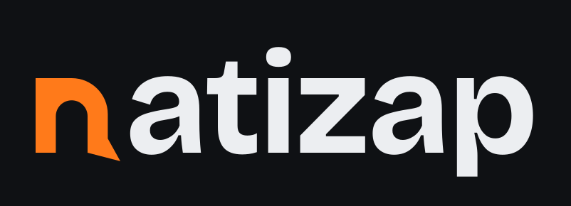
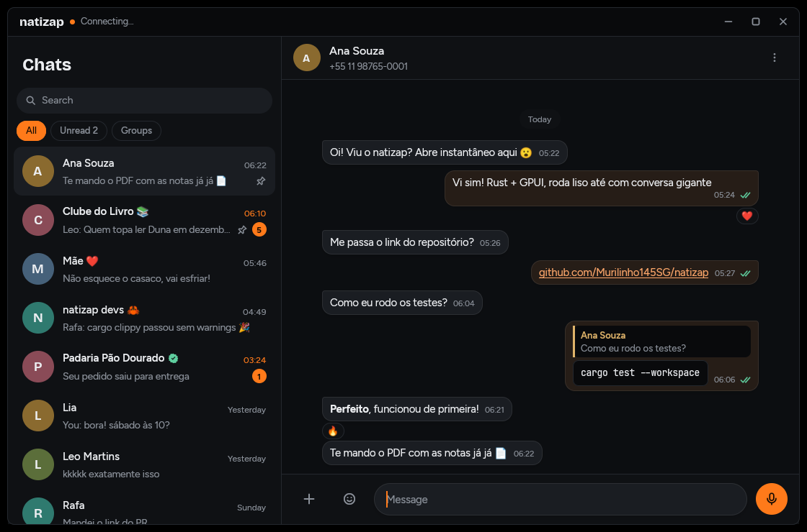

<p align="center">
  
</p>

<p align="center">
  A native desktop WhatsApp client, written in Rust with
  <a href="https://gpui.rs">GPUI</a>, the GPU-accelerated UI framework behind Zed.
</p>

<p align="center">
  <a href="LICENSE"></a>
  
  
</p>



<sub>The screenshot uses made-up chats and numbers.</sub>

## Why

WhatsApp Web and the official desktop apps are slow, memory-hungry and
unreliable; only the phone apps feel good. natizap aims to give the desktop
the same quality: instant startup, smooth scrolling through long chats, low
memory use, and an interface that never makes you wait.

It links to your phone as a companion device, exactly like WhatsApp Web, and
speaks the WhatsApp multi-device protocol directly through
[whatsapp-rust](https://github.com/oxidezap/whatsapp-rust). Messages stay
end-to-end encrypted; keys and history live only on your machine.

## What works today

- **Linking** by QR code, with the chat list and history synced from the phone
  and cached locally, so it opens instantly, even offline.
- **Chat list**: search by name or number, and through every chat's
  messages, unread and group filters, archived chats, pins, mutes, unread
  counts and verified business seals. A right click on a chat archives,
  mutes, pins, marks it read or unread, blocks, clears or deletes it
  without opening it.
- **Conversations**: WhatsApp formatting, clickable links, email addresses,
  phone numbers and Brazilian tax IDs, code blocks with syntax colors,
  replies that jump to the quoted message, reactions, forwarding, starring,
  pinning and deleting, text selection and copying, search through the
  whole chat, and missed calls marked in their chat.
- **Mentions**: typing `@` in a group lists its members to pick from;
  mentions show the person's name and open their profile when clicked.
- **Media**: photos with a full-size viewer, pictures sent together folded
  into one album, videos in a built-in player, voice notes with their
  waveform and playback speeds, documents with their first page, stickers,
  shared contacts and polls, voted on with a click and tallied as votes
  arrive, and the pictures in businesses' messages.
- **Stickers**: favorites synced with the phone, sent from the same tray as
  the emoji, and any sticker in a chat added to them with a click.
- **Sending**: text, recorded voice notes, contacts and polls, and files,
  photos and documents dropped, pasted or picked, previewed first with a
  caption for each, up to 30 at once.
- **Profiles** of people, businesses (seal, hours, banner, links) and groups
  (members and admins), with presence: online, last seen and typing, and
  every photo, video, document and link a chat shared, by month and
  searchable. Your own name, about line and picture can be changed.
- **Status**: everyone's updates of the last day, played in a viewer,
  replied to, and your own posted, text or media.
- **Voice and video calls**: one-to-one calls placed from a chat and
  answered or declined from a card that rings, kept in a bar across the
  window while you keep chatting, docked over the chat, filling its area,
  floating as a small picture, in a window of their own or full screen.
  A video call's pictures are tiles: focus any of them, drag the others
  to any corner, or see them side by side. The camera turns a voice call
  into a video call at any time, echo is cancelled, and three ringtones
  are drawn in code.
- **Screen sharing** in any call, with or without a camera (WhatsApp
  needs one), the camera shown in the shared screen's corner.
- **Calls history**: missed and answered calls, each a way to its chat.
- **Themes**: natizap's own Graphite and ports of well-known palettes
  (Catppuccin, Dracula, GitHub, Nord, …), plus themes of your own made in
  the settings, with the app icon following the theme in the tray and the
  dock.
- **Tray**: closing the window keeps natizap running, connected and
  notifying.
- **Notifications**: system notifications while natizap is in the
  background, opening the chat when clicked, and a chime for new messages
  outside the chat on screen, with a choice of tones for chats and groups;
  muted chats stay silent.

## Not yet

Group calls, channels and communities are on the roadmap.
natizap targets full parity with the phone apps, calls included.

## Caveat

natizap is an unofficial client built on a reverse-engineered protocol. It is
not affiliated with WhatsApp or Meta. WhatsApp may change the protocol at any
time or restrict accounts that use unofficial clients: use it at your own
risk.

## Installing

Every [release](https://github.com/Murilinho145SG/natizap/releases) has
builds for x86-64 (Intel and AMD) and ARM64 (Apple Silicon on a Mac):

| System                      | x86-64                                   | ARM64                                     |
| --------------------------- | ---------------------------------------- | ----------------------------------------- |
| Debian, Ubuntu, Mint        | `natizap_<version>-1_amd64.deb`          | `natizap_<version>-1_arm64.deb`           |
| Fedora, openSUSE, RHEL      | `natizap-<version>-1.x86_64.rpm`         | `natizap-<version>-1.aarch64.rpm`         |
| Arch, Manjaro               | `natizap-<version>-1-x86_64.pkg.tar.zst` | `natizap-<version>-1-aarch64.pkg.tar.zst` |
| Any Linux                   | `natizap-<version>-x86_64.AppImage`      | `natizap-<version>-aarch64.AppImage`      |
| Any Linux, unpacked by hand | `natizap-<version>-x86_64-linux.tar.gz`  | `natizap-<version>-aarch64-linux.tar.gz`  |
| Windows 10 and 11           | `natizap-<version>-x86_64-setup.exe`     | `natizap-<version>-arm64-setup.exe`       |
| Windows, without installing | `natizap-<version>-x86_64-windows.zip`   | `natizap-<version>-arm64-windows.zip`     |
| macOS 11 and later          | `natizap-<version>-x86_64-macos.dmg`     | `natizap-<version>-aarch64-macos.dmg`     |

On a Mac, open the `.dmg` and drag natizap onto Applications. natizap is
not signed with an Apple Developer ID yet, so the first time you open it
macOS refuses: go to System Settings → Privacy & Security and choose
**Open Anyway**. It opens normally from then on.

natizap keeps itself up to date: when a new release is out it downloads it
in the background, checks it against the release's `SHA256SUMS`, and offers
to restart into it from the title bar. Packages are installed through your
package manager (it asks for your password); the AppImage and the Windows
installer update in place. The archive, the zip and the Mac app only tell
you a release is out.

## Building

natizap builds FFmpeg from source and links it statically, which needs `nasm`
and `libclang`, plus the usual GPUI dependencies. On Linux, sharing the screen
in a call reads it through PipeWire, which needs its development files. On
Debian or Ubuntu:

```sh
sudo apt install nasm libclang-dev libpipewire-0.3-dev
cargo run --release
```

On a Mac, Xcode brings `libclang` and the Metal compiler GPUI needs;
`brew install nasm` adds the rest.

If `LIBCLANG_PATH` points at a cross-compiling clang (embedded toolchains often
export one), FFmpeg's bindings are generated for the wrong target and the
build fails with a pointer-size assertion. Unset it, or point it at the system
clang, for example `LIBCLANG_PATH=/usr/lib/llvm-21/lib cargo build`.

Before sending a change, all of these must pass with no warnings:

```sh
cargo fmt --all --check
cargo clippy --workspace --all-targets -- -D warnings
cargo test --workspace
```

## How it is organized

Every feature is its own crate under `crates/` (`natizap-chats`,
`natizap-messages`, `natizap-contacts`, …), shared code lives in a few small
crates (`natizap-protocol`, `natizap-ui`, `natizap-playback`, …), and the
`natizap` binary only wires them together. [AGENTS.md](AGENTS.md) explains the
architecture and the rules every change follows.

## Contributing

Contributions are welcome. Read [CONTRIBUTING.md](CONTRIBUTING.md) before
opening a pull request, and follow the [Code of Conduct](CODE_OF_CONDUCT.md).

## License

natizap is free software under the
[GNU Affero General Public License v3.0 or later](LICENSE).

It bundles third-party work under its own licenses: FFmpeg (LGPL-2.1-or-later,
built from source and linked statically), and the Figtree, Bricolage Grotesque,
JetBrains Mono and Noto Color Emoji fonts (SIL Open Font License 1.1).
